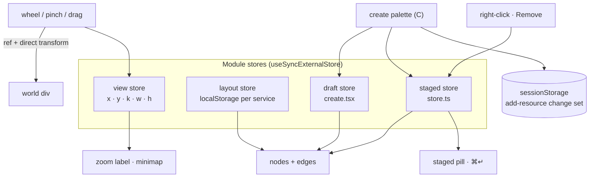

# Architecture

## Folder layout

```
src/
  app/
    layout.tsx                 root: fonts, Providers (theme, tooltips, toasts)
    page.tsx                   redirects / → /canvas
    not-found.tsx              global 404
    [mode]/                    mode ∈ canvas | classic
      layout.tsx               validates mode, mounts AppShell (inside Suspense)
      page.tsx                 Home
      services/ inbox/ activity/ projects/ infra/ network/ secrets/ kafka/ postgres/ …
      services/[service]/
        layout.tsx             ServiceFrame (tabs, env switch) + ServiceOpsHost (?op= dialogs)
  components/
    idp/kit.tsx                shared design-system pieces (see below)
    shell/                     AppShell, Canvas topbar, Classic sidebar/topbar, overlays (⌘K, menus, notifications)
    screens/<area>/            one folder per feature area; each exports a Canvas and a Classic view
    ui/                        shadcn primitives (Base UI)
  lib/
    data.ts                    core dummy data
    data-ext/<area>.ts         extra fixtures per feature area
    mode.ts                    useMode / useHref / useSwapModeHref
    utils.ts                   cn()
public/
  brand/ logos/ textures/      logo, avatar, integration marks, dither texture
docs/                          project documentation
```

## Routing model

- Every route lives under `src/app/[mode]/…`, so each path exists at both `/canvas/x` and `/classic/x`.
- A page renders `mode === "canvas" ? <CanvasX/> : <ClassicX/>`.
- The mode toggle swaps only the first URL segment, so you stay on the same screen.
- Use `useHref()("/inbox")` to build links that stay in the current mode.
- Dialogs and secondary states are URL-addressable, so every design frame can be linked directly. Examples: `?op=promote`, `?confirm=1`, `?tab=acls`, `?step=configure`, `?state=failed`. The full list is in [ROUTES.md](ROUTES.md).
- Next 16 runs with cache-components strictness:
  - Pages that read search params wrap their screen in `<Suspense>`.
  - Nothing reads `new Date()` during render.
  - The mode layout sets `instant = false`.

## Design tokens

`src/app/globals.css` defines the tokens from the Paper file as CSS variables. `:root`/`.dark` hold the dark theme and `.light` holds the light theme. They are exposed to Tailwind as semantic utilities:

| Purpose | Utilities |
|---|---|
| Surfaces | `bg-page`, `bg-surface`, `bg-surface-2`, `bg-surface-3` |
| Lines | `border-line`, `border-line-2`, `border-line-3` |
| Text | `text-foreground`, `text-muted-foreground`, `text-subtle`, `text-faint` |
| Accent | `primary` (#E85002) |
| Status | `success`, `warning`, `info`, `destructive` |

Component classes: `card-gloss`, `btn-primary-gloss`, `btn-secondary-gloss`, `dot-grid` and `skeleton-shimmer`.

Rules:
- Never hard-code hex values in components.
- Use `light:` for light-only tweaks.

## Shared kit (`components/idp/kit.tsx`)

- **Actions:** `Btn` (primary / secondary / outline / ghost / destructive / link, sizes xs–lg, `href`, `kbd`).
- **Status:** `StatusPill` / `StatusText` (the 8-state lifecycle), `StatusDot`, `EnvChip` (only PROD is coloured).
- **Brand:** `IntegrationLogo` (colour or theme-aware mono), `LogoTile`, `BrandMark`, `UserAvatar`.
- **Data viz:** `Spark` (animated sparkline).
- **Surfaces:** `GlossCard`, `Panel`, `SectionLabel`, `Eyebrow`, `Kbd`.
- **Motion:** `FadeIn`, `Stagger` / `StaggerItem`, `ease`.
- **Hooks:** `useHotkey`.

Working indicator (`components/idp/working.tsx`): `PixelGrid` (LED dot-matrix, patterns `ripple` / `rise` / `scan`), `WorkingText` (glow sweep) and `WorkingPill` (both, with cross-fading step labels). Use it instead of a spinner for anything that takes more than a second or two. The keyframes (`px-pulse`, `text-sweep`) live in `globals.css`.

## Service canvas

`screens/service/canvas.tsx` is a small node-graph engine. `resources.tsx` renders it in Canvas mode and the table in Classic.



- **No re-render while moving.** Pan and zoom write the transform to the DOM; only the HUD subscribes to the view store.
- **Layout.** Defaults are computed from the resource list. Dragged positions are saved to `localStorage` under `idp.canvas.layout.v1.<service>`.
- **Drafts.** Resources created from the palette live in a per-service store and are also written to the add-resource change set, so `/add/review` lists them.
- **Removals.** Staged as `rm-<resource>` entries in the staged store; nothing is deleted until the change set is applied.

## State

There is no backend. Screens read fixtures and keep interactions in React state. A few small cross-screen stores exist:
- `screens/service/store.ts` — staged changes on a service.
- `screens/secrets/store.ts` — the secrets access log.
- `data-ext/add-resource.ts` — the add-resource change set, kept in sessionStorage (read with `readStagedRaw` + `useSyncExternalStore`).
- `screens/service/create.tsx` — drafts created on the canvas.
- `screens/service/canvas.tsx` — canvas layout per service (localStorage) and the view store.

Client-only values (localStorage, sessionStorage, the current date, "is mounted") are read with `useSyncExternalStore` and a server snapshot, never with `setState` in an effect. This keeps hydration clean and `npm run lint` at zero.

To replace fixtures with real APIs, swap the imports in each `screens/<area>` module for data hooks.

## Motion and interaction standard

The full standard is in [DESIGN_IMPLEMENTATION.md](DESIGN_IMPLEMENTATION.md).
- **Motion:** durations 150–450 ms with ease `[0.22, 1, 0.36, 1]`. Use shared-layout pills (`layoutId`) for tabs and toggles and spring-in panels. Reduced motion is respected globally.
